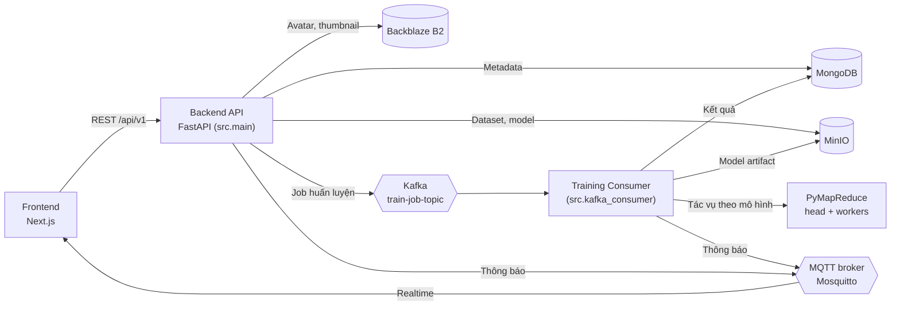

# Kiến trúc hệ thống

HAutoML gồm frontend, backend API và các tiến trình huấn luyện nền, giao tiếp qua hàng đợi tin nhắn. Các dịch vụ hạ tầng (cơ sở dữ liệu, lưu trữ, hàng đợi, broker MQTT) có thể chạy bằng Docker Compose.

## Sơ đồ tổng quan



## Các thành phần

| Thành phần | Công nghệ | Vai trò |
|------------|-----------|---------|
| **Frontend** | Next.js, React, TypeScript, Tailwind CSS, Radix UI, Redux Toolkit | Giao diện web |
| **Backend API** | FastAPI, Uvicorn | REST API, xác thực, điều phối job. Chạy bằng `python -m src.main` |
| **Training Consumer** | Python, aiokafka | Nhận job từ Kafka, chạy pipeline AutoML. Chạy bằng `python -m src.kafka_consumer` |
| **PyMapReduce** | `pymapreduce-core` | Chạy các tác vụ huấn luyện song song, ở chế độ `local` hoặc `cluster` (head + worker) |
| **MongoDB** | PyMongo (async) | Người dùng, siêu dữ liệu dataset, job, thông báo |
| **MinIO** | miniopy-async | Dữ liệu dataset (Parquet) và model artifact |
| **Backblaze B2** | S3 API | Ảnh đại diện người dùng, thumbnail dataset |
| **Kafka** | aiokafka | Hàng đợi job huấn luyện, và lệnh hủy job |
| **MQTT** | Mosquitto, aiomqtt | Đẩy thông báo realtime tới trình duyệt |
| **Demo UI** | Gradio | Giao diện thử nghiệm độc lập (`python -m demo.app`, cổng 7860) |

## Cấu trúc mã nguồn backend

Backend theo kiến trúc **module hóa**; mỗi module nghiệp vụ tách thành các lớp `router` → `service` → `repository`, cùng `schemas` (Pydantic).

```text
src/backend/
├── assets/                 # Cấu hình mô hình & lưới siêu tham số (*.yml), mẫu email
├── deploy/                 # Dockerfile, docker-compose, script khởi động PyMapReduce
├── demo/                   # Demo UI (Gradio)
├── tests/                  # unit/ và integration/
└── src/
    ├── main.py             # FastAPI app, đăng ký router
    ├── kafka_consumer.py   # Tiến trình huấn luyện nền
    ├── config/             # settings (biến môi trường), databases, logging
    ├── core/               # constants, dependencies, security (JWT), middlewares,
    │                       # exceptions, responses, search_space
    ├── adapters/           # Kết nối 12 loại CSDL ngoài
    ├── shared/             # Client dùng chung: kafka, mqtt, minio, backblaze, email, mapreduce
    └── modules/
        ├── auth/           # Đăng ký, đăng nhập, Google OAuth, OTP, đặt lại mật khẩu
        ├── users/          # Hồ sơ, avatar, đổi mật khẩu
        ├── datasets/       # Upload, import từ CSDL, tạo job huấn luyện
        ├── preprocessing/  # Tiền xử lý & chọn chiến lược CV
        ├── hpo/            # 5 thuật toán tối ưu siêu tham số
        ├── models/         # Registry các lớp mô hình
        ├── trainings/      # Pipeline huấn luyện, executor, tác vụ phân tán
        ├── inference/      # Triển khai, dự đoán, xuất mô hình
        └── notifications/  # Thông báo (MongoDB + MQTT)
```

Các router được đăng ký trong [main.py](https://github.com/optivisionlab/AutoML/blob/main/src/backend/src/main.py) dưới tiền tố `/api/v1`: `auth`, `users`, `notifications`, `datasets`, `inference`. Module `trainings` không có router vì chỉ chạy trong consumer.

### Bộ chuyển đổi CSDL (adapters)

Lớp `adapters` (`base.py`, `factory.py`) cung cấp giao diện chung để kết nối và đọc bảng từ CSDL ngoài. Hiện hỗ trợ: PostgreSQL, MySQL, SQLite, DuckDB, Snowflake, BigQuery, ClickHouse, MSSQL, Oracle, Trino, Hive và Redshift. Xem [API datasets](backend_api.md#ket-noi-csdl-ngoai).

## Luồng huấn luyện

1. Người dùng gọi `POST /datasets/{id}/training`. API ghi một bản ghi job (`status = 0`) vào MongoDB.
2. API gửi tin nhắn tới Kafka topic `train-job-topic` với `key = job_id`.
3. Training Consumer nhận tin nhắn, tải dataset từ MinIO, tiền xử lý và chọn chiến lược CV.
4. Mỗi mô hình ứng viên được gửi qua PyMapReduce như một tác vụ riêng; tác vụ chạy HPO và đánh giá mô hình.
5. Consumer gom kết quả, chọn mô hình tốt nhất theo `metric_sort`, đóng gói artifact và lưu lên MinIO.
6. Consumer cập nhật job (`status = 1` hoặc `-1`) và gửi thông báo.

Để hủy job, `POST /inference/jobs/{id}/cancel` gửi lệnh `cancel` vào cùng topic; consumer sẽ hủy tác vụ đang chạy.

## Thông báo realtime (MQTT) { #thong-bao-realtime-mqtt }

Với mỗi sự kiện của job, `NotificationService` lưu thông báo vào MongoDB rồi publish (QoS 1) lên topic riêng của người dùng:

```text
hautoml/users/{user_id}/notifications
```

Frontend subscribe topic này để cập nhật tức thời; danh sách thông báo cũ lấy qua [API notifications](backend_api.md#5-thong-bao-notifications-notifications).

## Xác thực và phân quyền

- JWT với `access_token` (mặc định 15 phút, `ACCESS_EXPIRE`) và `refresh_token` (mặc định 7 ngày, `REFRESH_EXPIRE`), refresh token đồng thời được đặt trong cookie `HttpOnly`.
- Đăng nhập bằng Google OAuth2.
- Xác thực email bằng liên kết hoặc OTP; đặt lại mật khẩu bằng OTP.
- Hai vai trò `user` và `admin`. Các dependency `require_admin` và `require_owner_or_admin` kiểm tra quyền ở tầng router.

## Công nghệ sử dụng

### Backend (Python ≥ 3.10)

- **Framework**: FastAPI, Uvicorn, Pydantic
- **Cơ sở dữ liệu**: MongoDB (PyMongo async)
- **Học máy**: scikit-learn, XGBoost, pandas, NumPy
- **Tối ưu siêu tham số**: scikit-optimize (Bayesian), Optuna (TPE), cài đặt riêng cho Grid, Random và Genetic Algorithm
- **Tính toán phân tán**: PyMapReduce
- **Hàng đợi / thông báo**: Kafka (aiokafka), MQTT (aiomqtt)
- **Lưu trữ**: MinIO, Backblaze B2
- **Xác thực**: Authlib, PyJWT
- **Container**: Docker, Docker Compose

### Frontend (TypeScript)

- **Framework**: Next.js, React
- **Quản lý trạng thái**: Redux Toolkit
- **Giao diện**: Tailwind CSS, Sass, Radix UI, Lucide React
- **Biểu đồ**: Recharts
- **Biểu mẫu**: React Hook Form, Zod
- **Client API**: Axios
- **Xác thực**: NextAuth.js
