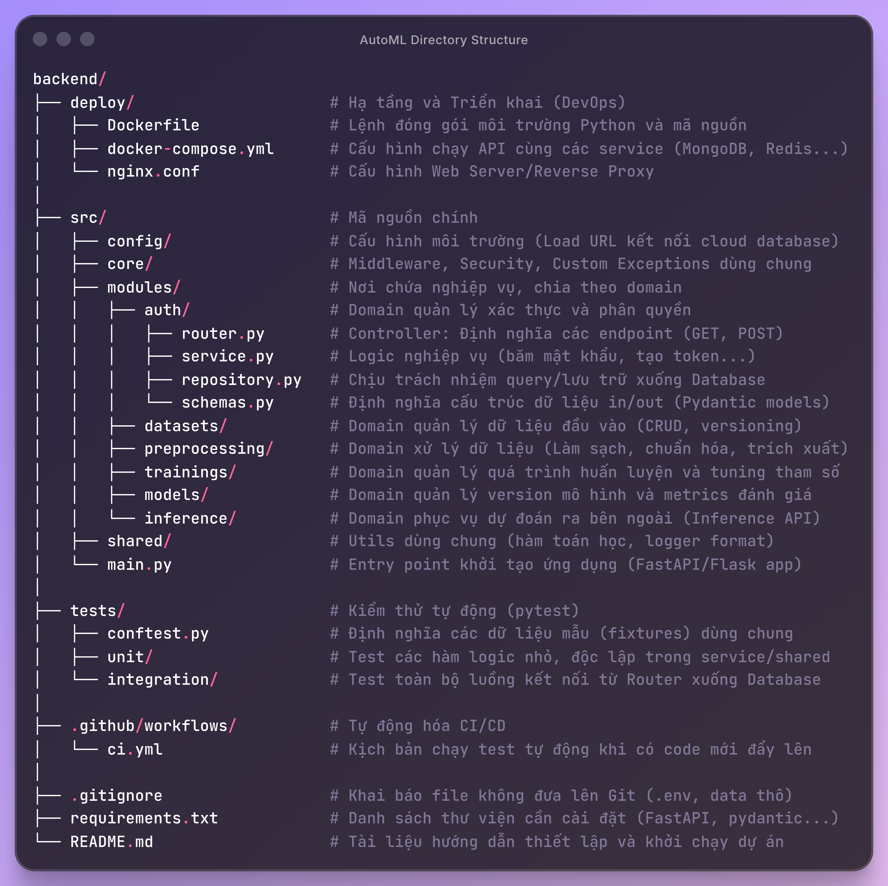

# HAutoML - Backend Service

Phân hệ Backend của nền tảng **HAutoML**, chịu trách nhiệm xử lý API REST, tiền xử lý dữ liệu, điều phối và thực thi huấn luyện mô hình (AutoML Pipeline), lưu trữ mô hình và cung cấp API suy luận (Inference).

---

## 1. Cấu trúc thư mục



---

## 2. Yêu cầu hệ thống

- **Python**: `>= 3.10`
- **Hạ tầng phụ trợ**:
  - MongoDB (cổng `27017`)
  - Apache Kafka (cổng `9092`)
  - MinIO (cổng `9000` / `9001`)
  - Mosquitto MQTT (cổng `1883` / `1884`)

> **Mẹo:** Bạn có thể khởi động nhanh các dịch vụ hạ tầng bằng Docker:
> ```bash
> cd deploy
> docker compose up -d mongo minio kafka mqtt
> cd ..
> ```

---

## 3. Cài đặt & Khởi chạy từ mã nguồn

### Bước 1: Chuẩn bị môi trường Python

Tại thư mục `src/backend`:

```bash
# Tạo và kích hoạt môi trường ảo
python3 -m venv venv
source venv/bin/activate       # Trên Windows: .\venv\Scripts\activate

# Cài đặt thư viện
pip install --upgrade pip
pip install -r requirements.txt
```

### Bước 2: Thiết lập biến môi trường

```bash
cp .env.example .env
```

Chỉnh sửa các thông số kết nối trong `.env` nếu cần (mặc định đã trỏ tới `localhost`):
- `MONGODB_CONNECT`: Kết nối MongoDB (`localhost:27017`)
- `MINIO_ENDPOINT`: Kết nối MinIO (`localhost:9000`)
- `KAFKA_SERVER`: Kết nối Kafka (`localhost:9092`)
- `MQTT_HOSTNAME`: Kết nối MQTT (`localhost`)
- `BACKEND_PORT`: Cổng chạy API (mặc định `9996` hoặc `9999`)

### Bước 3: Khởi chạy các tiến trình

Hệ thống backend gồm 2 thành phần chính cần chạy song song:

**1. Khởi chạy FastAPI Server (API Gateway):**
```bash
python -m src.main
# Hoặc dùng uvicorn:
# uvicorn src.main:app --host 0.0.0.0 --port 9999 --reload
```
- API Server: `http://localhost:9999` (hoặc cổng cấu hình trong `.env`)
- Tài liệu Swagger UI: `http://localhost:9999/docs`

**2. Khởi chạy Training Worker (Kafka Consumer):**
Mở terminal mới, kích hoạt `venv` và chạy:
```bash
python -m src.kafka_consumer
```
Worker sẽ lắng nghe các tác vụ từ Kafka topic (`train-job-topic`) và thực thi pipeline tiền xử lý + huấn luyện mô hình.

---

## 4. Các công cụ mở rộng (Tùy chọn)

### Chạy Standalone Demo UI (Gradio)
Bộ giao diện kiểm thử nhanh các thuật toán tiền xử lý và tìm kiếm mô hình:
```bash
python -m demo.app
```
Truy cập tại: `http://localhost:7860`

### Chạy cụm phân tán PyMapReduce (Bare-metal)
- **Head Node:**
  ```bash
  ./deploy/start_head.sh --port 7777 --scheduler Adaptive
  ```
- **Worker Node:**
  ```bash
  ./deploy/start_worker.sh --head-addr 127.0.0.1:7777
  ```
- **Dừng cụm:**
  ```bash
  ./deploy/stop_cluster.sh
  ```

---

## 5. Triển khai nhanh với Docker Compose

Nếu muốn khởi chạy toàn bộ backend cùng tất cả dịch vụ đi kèm trong Docker:

```bash
cd deploy
cp ../.env.example ../.env
docker compose up -d --build
```

Dừng hệ thống:
```bash
docker compose down
```

---

## 6. Chạy kiểm thử (Testing)

```bash
pytest tests/ -v
```
